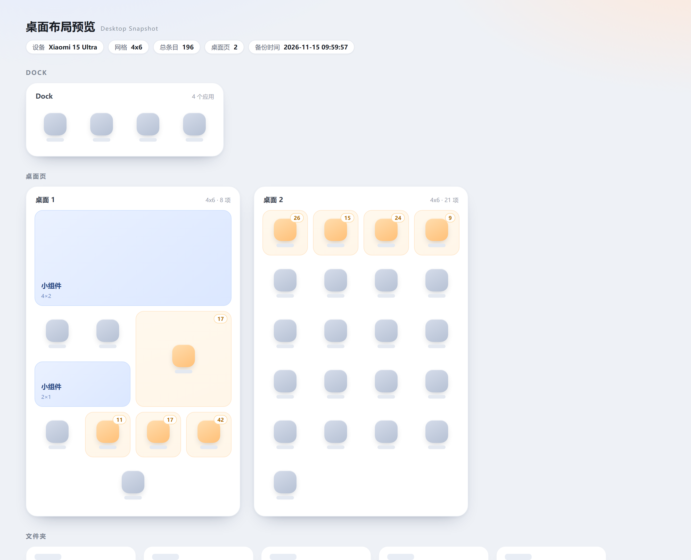
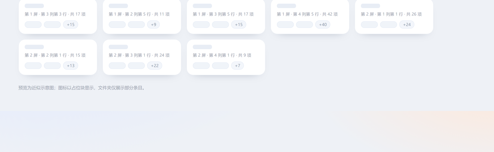

# HyperOS 桌面备份 / 查看 / 恢复工具（PC 脚本）

> 适用：已 root 的小米 / Redmi 手机（HyperOS），通过 USB + adb 连接电脑，备份「系统桌面」的图标布局，随时查看预览，并能一键恢复；恢复时遇到备份里有、但当前已卸载的应用**不会报错中止，而是跳过并在终端提醒**。
>
> **实测说明**：目前**仅在 Xiaomi 15 Ultra 上实测过**，其他小米 / Redmi 机型与系统版本理论上兼容但尚未实测，使用前请先做好备份。

---

## 预览



*HTML 预览页：Dock、每屏网格、文件夹、小组件占位一目了然；顶部显示设备 / 网格 / 条目数 / 备份时间*



*每个文件夹里的应用也在同一页面列出，并标注它原来在第几屏第几行*

```
Hyper-Desktop-Backup\
├── miui_launcher.py     # 底层：adb 连接、root 读写桌面数据库、快照/回写
├── miui_desktop.py      # 命令行工具（入口）
├── docs/                # README 用截图，含 HTML 预览渲染
├── .gitignore           # 忽略 __pycache__/ 与 备份记录/（备份数据不上传）
└── README.md
```

---

## 2. 环境要求

| 项目 | 要求 |
|---|---|
| 手机 | 小米/Redmi（HyperOS），已 **root**（Magisk / KernelSU / 皮皮虾等均可）**（仅在 Xiaomi 15 Ultra 实测）** |
| 手机开启 | 开发者选项 → USB 调试 |
| 电脑 | Windows + Python 3.8+（本机 3.12 已装） |
| adb | 任意 platform-tools 的 `adb.exe` |

**准备检查（两种情况通过其一即可连接）：**

```powershell
# 方式一：USB 数据线，开 USB 调试，手机上允许授权
python miui_desktop.py list

# 方式二：同一 Wi-Fi 下的无线调试，先插线执行下面命令再拔线
adb tcpip 5555
adb connect 手机IP:5555
```

> 工具只读/写系统桌面（`com.miui.home`）的数据库，不做任何其它系统改动。

---

## 3. 快速开始（3 步）

```powershell
# ① 插上手机，备份当前桌面（自动带时间戳，并默认生成 HTML 预览）
python miui_desktop.py backup

# ② 查看备份内容（文本网格预览 / HTML）
python miui_desktop.py view 备份记录\备份_20260830_153000\桌面备份_20260830_153000.json
python miui_desktop.py view 备份记录\备份_20260830_153000\桌面备份_20260830_153000.json --html

# ③ 万一以后桌面乱了，恢复（不带文件名=自动扫描并让你挑）
python miui_desktop.py restore
```

备份默认保存在「**当前目录下的 `备份记录\` 文件夹**」（不存在会自动创建），**每次备份都会建一个带时间戳的独立子文件夹**，JSON / HTML / raw 都在各自那次备份的文件夹里，结构如下：

```
备份记录\
├── 备份_20260830_153000\               ← 一次手动 backup = 一个文件夹
│   ├── 桌面备份_20260830_153000.json   ← 文字级备份（含图标数据，json 可读/可改）
│   ├── 桌面备份_20260830_153000.html   ← HTML 预览（双击即看图）
│   └── raw_20260830_153000\            ← 加 --raw 时另存原始数据库原件
├── 备份_20260831_091200\
│   └── 桌面备份_20260831_091200.json / .html
└── 恢复前备份_20260830_154000\         ← 每次 restore 前自动生成，独立文件夹便于区分
    └── 恢复前备份_20260830_154000.json
```

- `备份_时间戳\`：手动 `backup` 生成的备份，一个文件夹 = 一次备份；
- `恢复前备份_时间戳\`：`restore` 动手前自动生成的双保险，与手动备份分开，一眼可辨；
- `restore` 会遍历扫描 `备份记录\` 下各「备份_」子文件夹里的 JSON 让你挑选。

加 `--raw` 会额外把原始数据库文件也存一份（最保险，理论用不上）。

---

## 4. 命令详解

### 4.1 `list` —— 列出已连接设备

```powershell
python miui_desktop.py list
```

输出每台设备的序列号 + 型号。多台机器同时插着时，`backup/restore` 会自动弹出选择列表。

### 4.2 `backup` —— 备份当前桌面

```powershell
python miui_desktop.py backup [--dir 输出目录] [--raw]
```

- 无参数：默认存到「当前目录下的 `备份记录\`」（目录不存在会自动创建）；
- HTML 预览**默认就会生成**，没有 `--html` 开关，要关掉请在代码里改；
- `--dir D:\mybackup`：自定义备份根目录（根目录下同样按次数生成子文件夹）；
- `--raw`：额外保留一份原始 `.db` 数据库原件（放该次备份文件夹 `raw_时间戳\` 下）。

> `backup` 会实时读取手机当前状态——通常先调成你满意的样子再备份留档，**每次默认同时生成 HTML 预览**。
> 小组件（时钟等）会连同备份一起保存，只是恢复时无法还原（见 FAQ Q5）。

### 4.3 `view` —— 查看布局

```powershell
# 看手机当前状态（不生成文件，即时读手机）
python miui_desktop.py view

# 看某份备份/布局 JSON（离线，手机可以不插）
python miui_desktop.py view 备份记录\备份_20260830_153000\桌面备份_20260830_153000.json

# 同时生成 HTML 网页预览（文件夹着色、小组件大块展示）；
# 生成位置：JSON 在哪个子文件夹，HTML 就放到同文件夹同名（同名替换）
# 不指定文件时实时读手机，存到 备份记录\当前桌面_时间戳.html
python miui_desktop.py view 备份记录\备份_20260830_153000\桌面备份_20260830_153000.json --html
```

输出示例：

```
Dock: 相册、短信、电话、相机

== 桌面1页 (网格 4x6) ==
  多功  ▦    | ·      | ·      | ·
  微信       | QQ     | [常用] | ·
  高德地图   | [音乐… | [购物… | [玩机]  |  [电量 ⚡]

== 文件夹 ==
  [201] 常用 (screen1 位2,2) 含17项: 抖音极速版、小红书、一木记账、支付宝、钉钉、Edge、豆包、千问、DeepSeek、ChatGPT、米家、格力+、e福州、BOSS直聘、智联招聘、智谱清言、哔哩哔哩
```

图示说明：
- `微信` 普通图标；
- `[常用]` 文件夹；
- `▦多功能时钟` 小组件（会显示它占的格子大小）；
- `(4)`/`·` 等无法用文字描述的条目与空格。

### 4.4 `restore` —— 恢复桌面

```powershell
# 不带文件：自动扫描 备份记录\ 下各「备份_」子文件夹的全部 JSON，列出（时间+项数）让你挑编号
python miui_desktop.py restore [-y] [--keep-widgets]

# 指定文件（可以是指定目录里的某份备份）
python miui_desktop.py restore 备份记录\备份_20260830_153000\桌面备份_20260830_153000.json [-y]
```

扫描选择界面长这样：

```
在 备份记录 中发现 2 份备份 JSON：
  [1] 桌面备份_20260830_155410.json  2026-08-30 15:54:10  共148项
  [2] 桌面备份_20260830_154853.json  2026-08-30 15:48:53  共148项
输入编号选择要恢复的备份(直接回车=q 取消): 
```

**恢复流程（自动）：**

1. 读取选中的备份 JSON；
2. 读取手机**当前已安装应用列表**；
3. 逐条比对，遇到「未安装 / 组件失效」的应用 → **跳过 + 提醒**，其余正常恢复；
4. 把恢复前的手机布局再自动备份一份独立子文件夹 `恢复前备份_时间戳\恢复前备份_时间戳.json`（双保险）；
5. 终端询问，输入 `yes` 确认（`-y` 可跳过确认）；
6. 写库 → 自动重启桌面 → 回读校验行数。

> **设计安全点：**
> - 每次都先自备份再动手，桌面改坏也能还原；
> - 设备端 `/sdcard/backup/mdtool/pre_*` 还会留一份换文件前的原始库；
> - 重复出现的同一应用只保留第一个位置；
> - 不会动小组件（DB 注入还原不了 widget 实例，恢复时跳过并提醒，槽位留空）；
> - 未知条目类型（如 2 / 4 / 14 / 22）原样保留，不丢不炸。

**终端输出长这样：**


**跳过提示长这样：**

```
以下 2 项将跳过（不写库，不影响其他项）：
  - 招商银行  (应用未安装: com.cmbchina.ccd.pluto.cmbActivity)
  - 多功能时钟 (小组件在恢复中无法还原，已跳过)
```

---

## 5. 高级配置（环境变量）

| 环境变量 | 作用 | 默认值 |
|---|---|---|
| `MIUI_ADB` | adb 路径 | `D:\Software\adb\platform-tools\adb.exe` |
| `MIUI_BACKUP_DIR` | 备份默认目录 | 当前目录下的 `备份记录` |
| `MIUI_LAUNCHER` | 桌面包名 | `com.miui.home` |
| `MIUI_DB_DIR` | 桌面数据库目录 | `/data/user_de/0/com.miui.home/databases` |

命令行 `--adb` 优先级高于环境变量。

---

## 6. 备份 JSON 结构（了解即可）

```jsonc
{
  "schema": 1,                      // 备份格式版本
  "created": "2026-08-30 15:30:00",
  "device": { "model": "25019PNF3C" },
  "grid": "4x6",                    // 桌面网格，自动探测
  "dbname": "/data/user_de/0/com.miui.home/databases/launcher4x6.db",  // 手机端完整路径
  "widgets_restorable": false,      // 常量，提示小组件无法还原
  "favorites": [ ... ],             // 桌面对象完整行（图标、位置、文件夹、小组件）
  "screens":   [ ... ]              // 屏幕页定义
}
```

- `favorites` 里每行对应：**Dock 图标 / 桌面图标 / 文件夹 / 文件夹内容 / 小组件**；
- 图片类的二进制字段用 `{"$b64":"..."}` 存放，恢复时自动还原；
- 这个 JSON 完全可读可改：你手动改几行位置，再用 `restore` 就能"手工 ps 桌面"。

---

## 7. 常见问题 FAQ

**Q1：`没有检测到已连接的设备`**
先 `adb devices` 确认手机在线；拔插一次数据线，手机上重新点「允许 USB 调试」；或用上面的无线方式连接。

**Q2：多台手机同时插着**
工具会列出来让你输编号选择，不会误操作到别的机器。也可以先 `adb devices` 拿到序列号，再用全局参数 `--serial 序列号` 直接指定，免去每次询问。

**Q3：恢复后桌面还是没变？**
正常工具会自动 `force-stop` 桌面再拉起。极端情况手动在手机上 `设置→应用→系统桌面→强行停止` 一次，或重启手机。

**Q4：备份里的 App 后来被卸载了**
恢复时自动跳过并提醒，其余不受影响，不会报错。

**Q5：小组件（时钟/日历卡片等）能不能恢复？**
不能精确还原——小组件是系统为"实例"保存的，DB 写不回来。所以恢复自动跳过，槽位留空；你可以恢复后自己重新添加。这也是 `view` 里小组件显示为占位块的原因。

**Q6：会不会把我的应用数据/聊天记录搞没？**
不会。工具只读写**桌面布局数据库**（图标摆放），不碰任何应用数据。

**Q7：root 有风险吗？**
有。任何 root 写操作都要谨慎。工具每次恢复前都自动留一份备份，最坏情况也能还原；但**强烈建议**大操作前先手动多存一份 `backup`。

**Q8：换手机 / 换机型能用吗？**
理论上可以。数据库路径和文件名自动探测（`launcher*.db`），grid 也从文件名识别；只要还是 HyperOS 桌面 + root 即可。但目前**仅在 Xiaomi 15 Ultra 上实测过**，其他机型使用前建议先手动 `backup` 留档。

---

## 8. 路线图（可选需求欢迎提）

- [x] CLI：备份 / 查看（文本 + HTML）/ 恢复（跳过 + 提醒）
- [x] HTML 预览增强：分屏卡片、文件夹弹窗、小组件占位、`launchCount` 点击热度参考
- [x] 数据库字段按实际表结构自适应（`PRAGMA table_info`），兼容 OS 升级后字段增删
- [ ] 按 `launchCount` 自动生成「低使用率应用」建议（用于桌面整理）
- [ ] 图形界面（tkinter）按钮化
- [ ] 定时自动备份
- [ ] 多备份横向 diff（哪份布局比现在差了哪几个图标）
- [ ] 打包成 `.exe`（PyInstaller），免装 Python

---

## 9. 免责声明

本工具用于个人设备的管理与备份，修改系统桌面数据库属 root 级操作。使用前请确保已理解原理并做好备份，因误操作导致的异常请通过备份还原，本工具不承担连带责任。